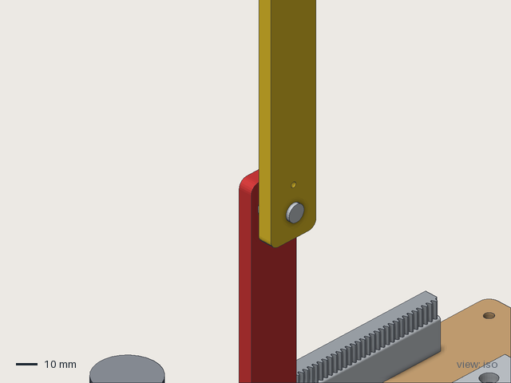

<!-- Slides for the 4-minute HTV pitch. Open in VS Code with the Marp extension (or marp-cli) to present
     or export to PDF/PPTX. Speaker notes are the HTML comments; the full timed script is in pitch.md.
     Images marked TODO need a screenshot from the live site. -->

<!-- _class: lead -->

# Physical Studio

## Say what you want to build.
## See every step in 3D, at real size.

physicalstudio.work

<!-- 0:00–0:15. "We're Physical Studio. You say what you want to build; we show you every step in 3D, at real size, and Gemini checks your work." -->

---

# Hardware tutorials make you guess

- A blurry photo: *which hole is that wire in?*
- A case that's **2 mm too small** for the board
- A screw that hits the header

<!-- 0:15–0:40. Tell it as a story: one of us, an evening, an LED that won't light. -->

---

# IKEA instructions work because IKEA knows **every part's size**

One change per step. Numbered pictures. And the picture is **true**.

We built that for electronics.

<!-- 0:40–0:55. This is the thesis slide: assembly visualization with correct dimensions. -->

---

# Prompt → animated 3D assembly guide

> *"Traffic light for an Arduino Uno: red, yellow and green LEDs in a column on the lid, a crosswalk button, USB accessible on the side."*

<!-- 0:55–1:55. SWITCH TO THE LIVE SITE: physicalstudio.work/guide?design=traffic-light.
     Play: board drops onto standoffs → screws spin down → LEDs slide into the lid → wires draw.
     Toggle exploded view. Click a part. Point at a callout. Back to slides at 1:55. -->

---

# Correct dimensions, not guesses

- **100+ parts** from datasheets, **checked with calipers**
- AI designs only through our **MCP tools**: it can't invent a number
- `check_interference` · `check_clearance` · `render_preview`
- Caught: an M3 screw head at the Uno's AREF hole **hits the header** → guide leaves it empty
- Case exported with cutouts and lid holes → **we printed it**

<!-- 1:55–2:30. Hold up the printed case. -->

---

# Gemini checks your work

Photo after each step → compared with that step's **expected 3D render** → a specific fix

> *"The red LED is in backwards: the long leg should go toward the resistor."*

<!-- 2:30–3:15. PLAY THE 40 s CLIP (docs/demo-mistake-catch.md): LED in backwards → photo → verdict → flip → pass.
     Replace the quote with the real verdict text. -->

---

# Past breadboards

**Double inverted pendulum**: rack-and-pinion cart on a linear rail, Teensy 4.1, motor driver, 2 magnetic encoders, 2 distance sensors

**23 parts · 33 steps · a 3D model per step**

<!-- 3:15–3:35. -->

---

# How it's built

**Prompt** → any model (Claude · Gemini · OpenAI · DeepSeek) → **MCP server** (FastMCP, build123d/OpenCascade, measured parts JSON) → checks → **GLB + steps JSON + STL** → **React Three Fiber** guide → **Gemini** step checks

Vultr · Docker · Caddy · physicalstudio.work (GoDaddy Registry .work)

<!-- 3:35–3:50. One breath; don't read the slide. -->

---

<!-- _class: lead -->

# Physical Studio

## What you see is what fits.

**physicalstudio.work**

<!-- 3:50–4:00. Stop talking. Q&A. -->
